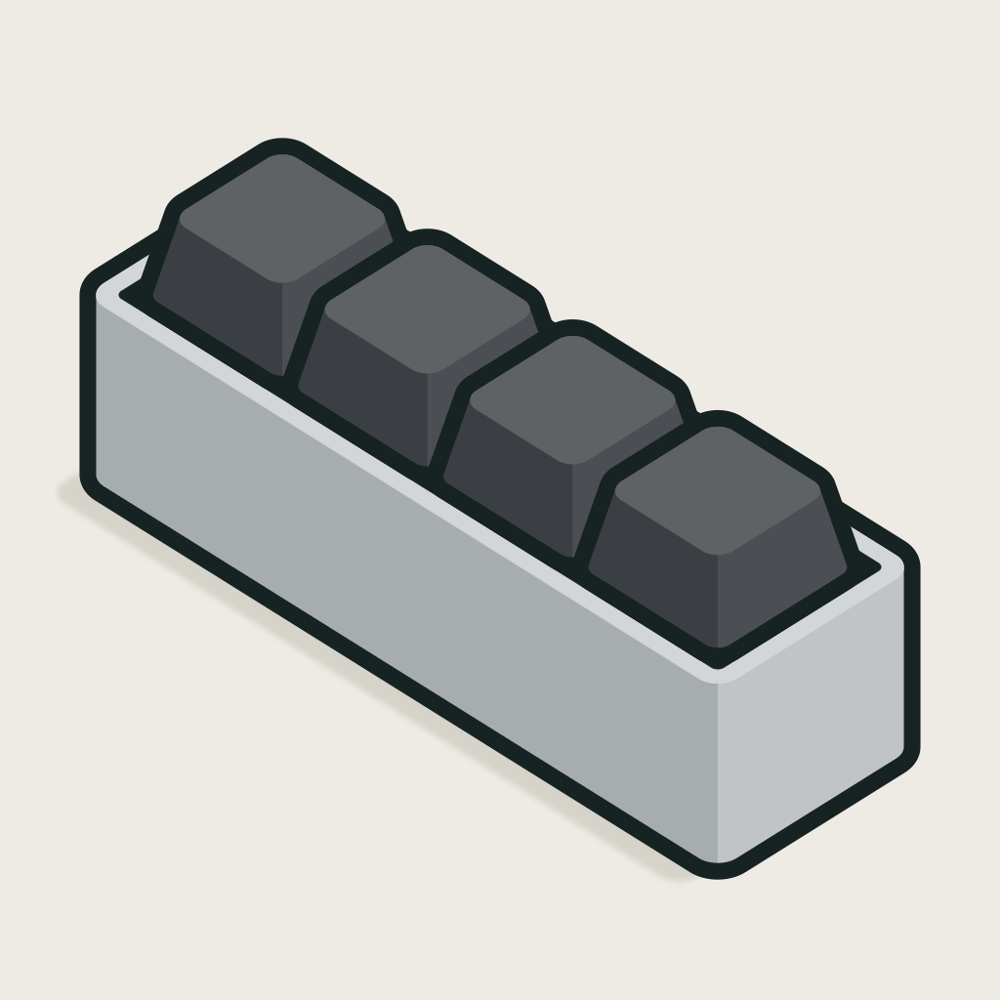

# ECmacro

ECmacro is a series of small USB keyboards (macro pads) that use electrostatic capacitive switch parts.
No special external components are needed to read the keys: just the microcontroller's GPIO pins and one resistor per key.

## Models

  
  

| | ECmacro 2V | ECmacro 4H |
|---|---|---|
| Features | Volume control; press both keys to mute | Key assignments adjustable in Remap and VIA |
| Microcontroller | CH552E | Seeed Studio XIAO RP2040 |
| Firmware | Custom ([firmware/ch552](firmware/ch552/)) | QMK ([firmware/rp2040](firmware/rp2040/qmk/keyboards/quadstate/ecmacro4h/)) |
| Schematic and PCB | [hardware/2V](hardware/2V/) | [hardware/4H](hardware/4H/) |

## Contents

| Folder | Contents |
|---|---|
| [hardware/](hardware/) | Schematic and PCB for each model (KiCad 10) |
| [firmware/ch552/](firmware/ch552/) | Firmware for the CH552E models; its README covers building and flashing |
| [firmware/rp2040/](firmware/rp2040/) | QMK keyboard definition, VIA definition, build scripts, a udev rule for Linux, and the firmware's [license, source and third-party notices](firmware/rp2040/THIRD-PARTY-NOTICES.txt) |

Case design files are not included.

## USB ID

All models use the USB VID:PID `1209:EC02` ([pid.codes](https://pid.codes/1209/EC02/)).

## License

- Schematics and PCBs (hardware/), images (images/) and documentation outside firmware/rp2040/: CC BY 4.0
- CH552 firmware (firmware/ch552/): MIT
- RP2040 firmware (firmware/rp2040/, including its readme): GPL-2.0-or-later (distributed firmware: GPLv3)

See [LICENSE](LICENSE) for details and [LICENSES/](LICENSES/) for the full texts. For the firmware written on the ECmacro 4H, [firmware/rp2040/THIRD-PARTY-NOTICES.txt](firmware/rp2040/THIRD-PARTY-NOTICES.txt) gives its license, where to get its complete source code, how to build and install it, and its third-party notices.

Copyright (c) 2025–2026 QuadState
